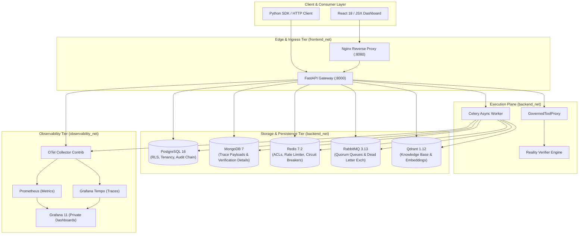

# MIRAGE 3.0 — AI Execution Assurance Platform

<div align="center">

[](https://github.com/VedantPanchal23/MIRAGE/actions/workflows/ci.yml)
[](https://www.python.org/)
[](https://fastapi.tiangolo.com/)
[](https://react.dev/)
[](https://www.docker.com/)
[](https://www.postgresql.org/)
[](#-authors--affiliation)

<br />

**“Control AI before it acts. Verify AI after it acts.”**

*A zero-trust, multi-tenant execution assurance platform governing autonomous agent lifecycles, capability authorizations, real-world tool execution, and postcondition verification.*

</div>

---

## 👥 Authors & Affiliation

- **Vedant (23AIML042)** — Department of Artificial Intelligence & Machine Learning, CSPIT
- **Dax (23AIML076)** — Department of Artificial Intelligence & Machine Learning, CSPIT
- **Institution**: Chandubhai S. Patel Institute of Technology (CSPIT), Charotar University of Science and Technology (CHARUSAT)
- **Academic Year**: 2026

---

## 🏛️ Executive Summary & Core Invariant

Modern autonomous agents and Large Language Models (LLMs) operate with dangerous epistemic unreliability: they hallucinate execution success, suffer from prompt injection, exceed operational blast radiuses, and conflate HTTP 200 responses with real-world state transitions.

**MIRAGE 3.0 is not a passive hallucination detector.** It is an active **AI Execution Assurance Platform** deployed as a mediating gateway between AI agents and external environments. Every consequential transaction traverses the **Five Assurance Gates**:


### The Invariant of Epistemic Outcome Independence
> **Core Guarantee**: An agent's assertion or a tool's internal execution return value is **never** proof of a real-world outcome. Outcome claims must be confirmed by independent reality verification gathered directly from postcondition state transitions.

---

## 🛡️ The Five Assurance Gates

### 1. Gate 1 — Input Assurance (Boundary Defense & Ingestion)
- **Tenant Attribution & Identity Binding**: Enforces cryptographic JWT verification and resolves tenant membership directly from PostgreSQL with Row-Level Security (RLS).
- **Anti-Spoofing Middleware**: ASGI boundary header stripping prevents client injection of internal headers (`X-Role`, `X-Tenant-Id`).
- **Dynamic Information Flow Control (DIFC)**: Taint tracking tags inputs with confidential and untrusted security classifications.
- **DLP & Prompt Injection Shield**: Scans payloads for direct/indirect injection, credential leaks, and PII before execution planning begins.

### 2. Gate 2 — Context Assurance (RAG & Working Memory)
- **Delimiter Isolation**: Strictly wraps context inside `<trusted_instructions>` and `<untrusted_data>` boundaries to defeat indirect prompt injection.
- **Evidence Provenance & Freshness**: Qdrant vector retrieval validates document age, generation IDs, and trust tiers.
- **Governed Memory Lifecycle**: Enforces epistemic tiers (`ATTESTED` vs. `ADVISORY`). Agents cannot self-attest or overwrite tenant truth. Poisoned context is quarantined fail-closed.

### 3. Gate 3 — Action Assurance (Authorization & Dispatch)
- **Capability-Based Access Control**: Agents possess least-privilege, short-lived capabilities. Unscoped actions are blocked at the proxy boundary.
- **Mandatory `GovernedToolProxy`**: Direct tool invocation is architecturally prohibited. Tool schemas and parameter ranges are strictly validated.
- **Sliding-Window Blast Radius**: Financial spend ceilings and cumulative risk budgets automatically throttle runaway agent execution.
- **SSRF & Network Boundary Defense**: Validates all outbound endpoints against IPv4/IPv6 loopback, link-local, RFC 1918 private subnets, cloud metadata (169.254.169.254), and DNS rebinding attacks.
- **Single-Use Human-in-the-Loop (HITL)**: Cryptographically binds approval tokens to action contracts. Agents cannot approve their own escalations.

### 4. Gate 4 — Output Assurance (Verification Engine)
- **Multimodal Consistency Pipeline**: Incorporates Retrieval-Augmented Verification (RAV), Semantic Consistency Scoring (SCS), Natural Language Inference (NLI), Information Consistency Scoring (ICS), and Visual Grounding Scoring (VGS).
- **Meta-Learner & Calibration**: LightGBM meta-learner combines gate metrics; Isotonic Regression guarantees Expected Calibration Error ($ECE < 0.05$) and Mondrian Conformal Prediction provides 95% coverage intervals.
- **Postcondition Honesty Enforcement**: If an agent claims *"I updated the database"* without a verified Gate 3 action contract, the claim is flagged as dishonest and blocked.

### 5. Gate 5 — Outcome Assurance (Reality Verification)
- **4-Class Epistemic Observability**: Categorizes reality verification into `OBS_DIRECT` (database/file), `OBS_EVENTUAL` (webhooks/events), `OBS_INFERRED` (indirect indicators), and `OBS_BLIND` (unverifiable external side effects).
- **Independent State Observers**: `DatabaseStateAdapter`, `HttpResourceAdapter`, and `AsyncEventAdapter` inspect target systems independently of the tool agent.
- **Monotonic Outcome State Machine**:
  ```mermaid
  stateDiagram-v2
      [*] --> PROPOSED
      PROPOSED --> AUTHORIZED: Gate 3 Approved
      AUTHORIZED --> EXECUTING: Two-Phase Commit Lease
      EXECUTING --> EXECUTION_UNCERTAIN: Timeout / Network Disruption
      EXECUTING --> PENDING_VERIFICATION: Tool Return Captured
      PENDING_VERIFICATION --> VERIFIED_SUCCESS: Postconditions Confirmed
      PENDING_VERIFICATION --> VERIFIED_FAILURE: Discrepancy Detected
      PENDING_VERIFICATION --> PARTIAL_ACHIEVEMENT: Subset Satisfied
      EXECUTION_UNCERTAIN --> VERIFIED_SUCCESS: Independent Reconciliation
      EXECUTION_UNCERTAIN --> VERIFIED_FAILURE: Reality Confirms No Mutation
  ```

---

## 🏗️ System Architecture & Storage Planes

MIRAGE separates control, execution, storage, and observability into isolated architectural planes:



---

## 🐳 Container Topology & Security Profiles

The production deployment runs 12 containers across 3 isolated Docker bridge networks:

| Container | Image | Network Tier | Security Profile & Hardening |
| :--- | :--- | :--- | :--- |
| `mirage-gateway` | `mirage-gateway:latest` | `frontend`, `backend`, `observability` | Non-root (`1000:1000`), read-only rootfs, `cap_drop: ALL`, tmpfs `/tmp`. |
| `mirage-worker` | `mirage-worker:latest` | `backend`, `observability` | Non-root (`1000:1000`), read-only rootfs, `cap_drop: ALL`, tmpfs `/tmp`. |
| `mirage-dashboard` | `mirage-dashboard:latest` | `frontend` | Non-root Nginx (`101:101`), read-only rootfs, security headers, reverse proxy. |
| `mirage-postgres` | `postgres:16.4-alpine3.20` | `backend` | Internal only. Enforces PostgreSQL RLS, separate admin & app user roles. |
| `mirage-redis` | `redis:7.2.5-alpine3.20` | `backend` | Internal only. Redis ACLs: separate `mirage_app` and `mirage_celery` users. |
| `mirage-mongodb` | `mongo:7.0.12` | `backend` | Internal only. Authenticated trace storage with automatic TTL indexes. |
| `mirage-rabbitmq` | `rabbitmq:3.13.6-management-alpine` | `backend` | Internal only. Quorum queues, DLX routing, secure user credentials. |
| `mirage-qdrant` | `qdrant/qdrant:v1.12.0` | `backend` | Internal only. HNSW indexing, authenticated API key protection. |
| `mirage-otel-collector` | `otel/opentelemetry-collector-contrib:0.108.0` | `observability` | Internal only. Telemetry router and OTLP gRPC buffer. |
| `mirage-tempo` | `grafana/tempo:2.6.0` | `observability` | Internal only. Distributed W3C trace context backend. |
| `mirage-prometheus` | `prom/prometheus:v2.54.1` | `observability` | Internal only. Scrapes Gateway `/metrics` with tenant cardinality bounds. |
| `mirage-grafana` | `grafana/grafana:11.2.0` | `observability` | Bound to `127.0.0.1:3001` (SSH/SSM port forwarding only; zero public ingress). |

---

## ⚡ Quick Start & Verification

### Prerequisites
- Python 3.12+ (or 3.13)
- Docker & Docker Compose v2.20+
- Node.js 20+ (for Dashboard development)

### 1. Repository Setup & Environment
```bash
git clone https://github.com/VedantPanchal23/MIRAGE.git
cd MIRAGE

# Copy production-ready template (safe placeholders)
cp .env.example .env

# Run database migration preflight check (Alembic Head: 023_governed_mcp_servers)
python scripts/migration_preflight.py --target-head 023_governed_mcp_servers
```

### 2. Launch Multi-Container Infrastructure
```bash
# Start the full 12-container hardened topology
docker compose up -d

# Verify all containers are running and healthy
docker compose ps
```

### 3. Run Verification & Test Suites
```bash
# 1. Five-Gate Live Smoke Test (19 automated checks)
python scripts/local_staging_smoke_test.py

# 2. Live Adversarial PostgreSQL RLS & Role Fencing Test
python scripts/test_live_adversarial_isolation.py

# 3. Live API Abuse, JWT Tampering, & Fuzzing Matrix
python scripts/test_api_abuse_matrix.py

# 4. Toxiproxy Chaos Engineering Harness (Network partitions & latency)
pytest tests/chaos/ -v

# 5. Core Gate 5 Uncertainty & Fail-Closed Security Suites
pytest tests/unit/test_gate5_uncertainty_remediation.py tests/integration/test_five_gates_e2e.py -v

# 6. React 18 / JSX Frontend Suite (Vitest)
cd dashboard && npm test -- --run
```

---

## 🐍 Official Python SDK (`mirage-sdk`)

MIRAGE includes a native, fully typed Python SDK supporting synchronous and asynchronous execution:

```python
from mirage_sdk import MirageClient
from mirage_sdk.models import ActionProposal, PostconditionRule, PostconditionOperator

# Initialize client with tenant API key
with MirageClient(base_url="http://localhost:8000", api_key="mirage_live_...") as client:
    # 1. Propose governed action with postcondition assertions
    action = client.propose_action(
        ActionProposal(
            action_type="EXECUTE_SQL",
            tool_name="database_query",
            parameters={"query": "UPDATE accounts SET balance = balance - 250 WHERE id = 42"},
            target_resource="db.accounts",
            idempotency_key="tx-acct-transfer-42-step-1",
            postconditions=[
                PostconditionRule(
                    target="db.accounts",
                    field="balance",
                    operator=PostconditionOperator.EQUALS,
                    expected_value=750,
                )
            ],
        )
    )
    print(f"Action Proposal ID: {action.action_id} (Status: {action.status})")

    # 2. Acquire concurrency lease and dispatch execution
    executed = client.execute_action(action.action_id)
    print(f"Execution State: {executed.status}")

    # 3. Execute Gate 5 Reality Verification independently
    outcome = client.verify_outcome(
        action_id=executed.action_id,
        observations={"observed_balance": 750},
    )
    print(f"Gate 5 Outcome: {outcome.status} (Confidence: {outcome.epistemic_confidence})")
```

---

## ☁️ AWS Private Staging Architecture

MIRAGE provides modular, cost-conscious **Terraform Infrastructure-as-Code** (`infra/terraform/`) and an AWS Staging Compose override (`docker-compose.staging.yml`) for private cloud deployment:

- **Cost-Conscious Footprint**: Single hardened `t3.large` instance ($0.0832/hr) running the proven 12-container topology in a dedicated VPC, eliminating expensive NAT Gateways and ALBs during initial validation.
- **Zero Public Inbound Ports**: Ingress is disabled by default (`admin_cidrs = []`). Administrative terminal access and port-forwarding operate exclusively via **AWS Systems Manager (SSM) Session Manager**.
- **KMS Encryption at Rest**: Customer Managed Key (CMK) with automated rotation encrypts EBS volumes, AWS Secrets Manager credentials, and S3 cold audit buckets.
- **Fail-Closed Staging Configuration**: Startup halts immediately if development fallback passwords (`mirage_dev_secret`, `mirage_redis_secret`) or default signing keys are detected.

```bash
# Format and validate IaC locally (requires zero cloud spend)
cd infra/terraform
terraform fmt -check
terraform init -backend=false
terraform validate
```

*For complete prerequisites, billing budget scripts, secret injection workflows, and controlled teardown runbooks, see [`docs/deployment/aws-private-staging.md`](docs/deployment/aws-private-staging.md).*

---

## 📜 Complete REST API Reference (`/v1/`)

| Route Group | Method & Endpoint | Description | Capability Required |
| :--- | :--- | :--- | :--- |
| **Auth & Tenants** | `POST /v1/auth/token` | Obtain tenant JWT bearer token | Public (API Key / Auth) |
| | `POST /v1/admin/tenants` | Provision new isolated tenant | `admin:write` |
| | `POST /v1/auth/api-keys` | Generate high-entropy tenant API key | `admin:write` |
| | `POST /v1/auth/api-keys/{id}/revoke`| Instantly revoke an active API key | `admin:write` |
| **Transactions** | `POST /v1/transactions` | Initialize governed AI transaction | `transaction:write` |
| | `GET /v1/transactions/{id}` | Query full transaction execution record | `transaction:read` |
| **Verification** | `POST /v1/verify` | Submit content for Gate 4 output assurance | `verify:execute` |
| | `GET /v1/verify/{id}/status` | Check async verification task status | `verify:read` |
| **Action Assurance** | `POST /v1/actions/propose` | Propose action contract with postconditions | `action:propose` |
| | `POST /v1/actions/{id}/execute` | Acquire lease and dispatch tool proxy | `action:execute` |
| **Outcome Assurance** | `POST /v1/outcomes/verify` | Trigger Gate 5 independent reality verification | `outcome:verify` |
| **Governed MCP** | `GET /v1/mcp/servers` | Discover registered MCP servers | `mcp:read` |
| | `POST /v1/mcp/servers/{id}/revoke` | Instantly revoke compromised MCP tool | `mcp:admin` |
| **Audit & Ledger** | `GET /v1/audit/records` | Query tamper-evident audit ledger | `audit:read` |
| | `GET /v1/audit/verify-chain` | Cryptographically verify SHA-256 chain | `audit:read` |
| **Health & Telemetry** | `GET /v1/health` | Liveness probe (container orchestrator) | Public |
| | `GET /v1/ready` | 6-backend readiness probe | Public |
| | `GET /metrics` | Prometheus metrics scrape endpoint | Internal / Admin |

---

## 🛡️ Documented System Limitations & Boundaries

In accordance with MIRAGE architectural principles and ADR records:
1. **Target-Side Fencing Boundary**: MIRAGE enforces two-phase commit leases (`EXECUTING`) prior to dispatch to prevent local blind redispatch. Target systems lacking native conditional mutation support (e.g., SMTP or generic webhooks) remain mediated-only; universal target-side fencing is not claimed across arbitrary third-party protocols.
2. **Database-Resident vs. External Storage**: Tamper-evident SHA-256 audit chains are serialized under PostgreSQL row locks and cross-checked against filesystem/HMAC-SHA256 notary anchor proofs. Full external WORM (Write Once Read Many) cloud object storage or public blockchain notarization requires provisioned external enterprise infrastructure.
3. **Hardware KMS Epistemic Shredding**: Memory deletion enforces cryptographic tombstoning and multi-store cache/vector eviction. True physical hardware key destruction requires integration with external dedicated HSM hardware.

---

## 📚 Documentation Index

- [Canonical Specification](docs/MIRAGE_3.0_Specification.md) — The authoritative system specification.
- [Glossary](docs/GLOSSARY.md) — Definitive definitions for all system terminology.
- [Technical Architecture](docs/Technical_Architecture.md) — Subsystem designs and communication protocols.
- [Security Architecture](docs/Security.md) — Threat model, capability security, and zero-trust boundaries.
- [API Specification](docs/API_Specification.md) — OpenAPI contracts and error specifications.
- [Python SDK & Integration](docs/SDK_and_Integration.md) — Developer integration patterns and client libraries.
- [AWS Private Staging Runbook](docs/deployment/aws-private-staging.md) — Cloud architecture, Terraform, and operational procedures.
- [Observability & Audit](docs/Observability_and_Audit.md) — Tracing, metrics, and cryptographic audit proofs.
- [Operational Runbooks](docs/runbooks/) — Incident triage, key rotation, and disaster recovery.
- [Architecture Decision Records (ADRs)](docs/ADRs/README.md) — Architectural change governance.
- [Project Changelog](docs/CHANGELOG.md) — Detailed version and migration history.

---

## 📜 Citation & Research Attribution

```bibtex
@software{mirage2026assurance,
  author = {Vedant and Dax},
  title = {MIRAGE 3.0: An AI Execution Assurance Platform},
  institution = {Chandubhai S. Patel Institute of Technology (CSPIT), CHARUSAT},
  year = {2026},
  url = {https://github.com/VedantPanchal23/MIRAGE}
}
```
*Academic and Research Project developed at CSPIT, CHARUSAT. All rights reserved.*
