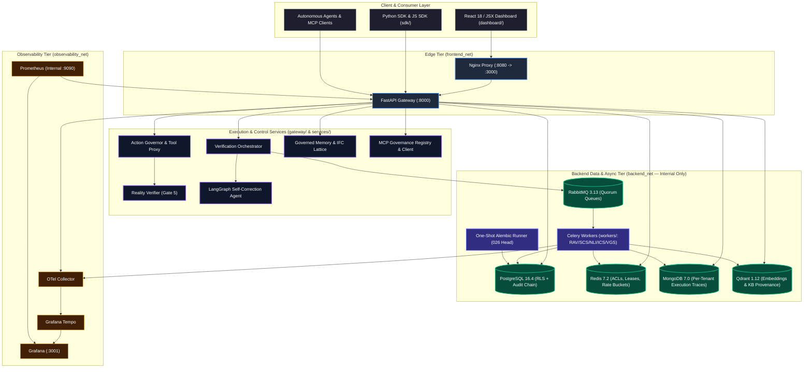
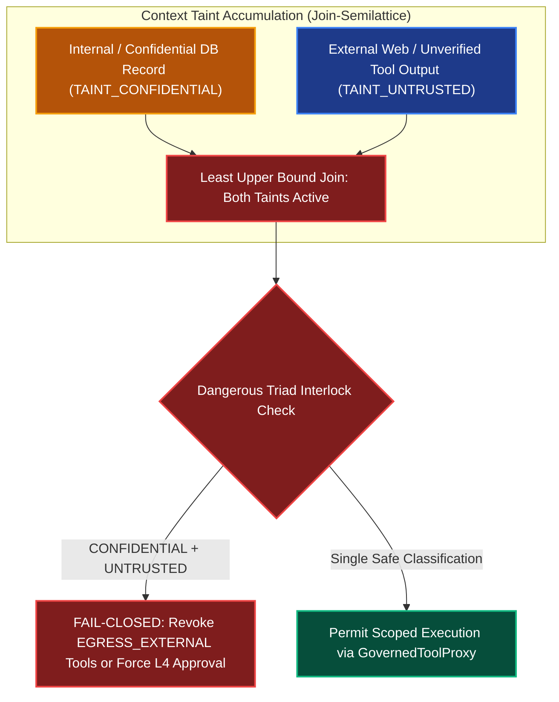
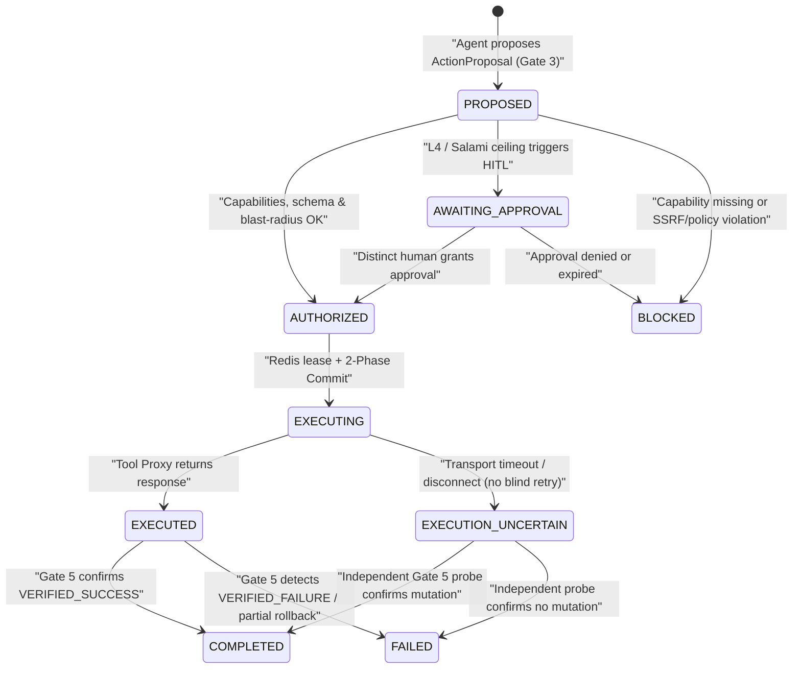
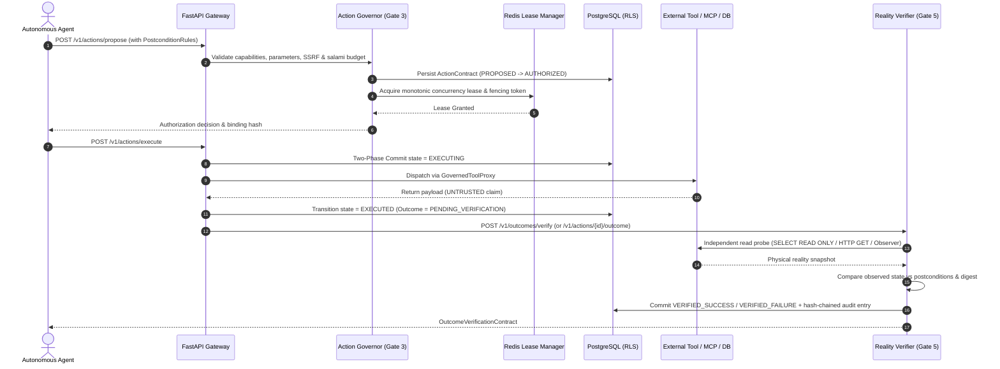
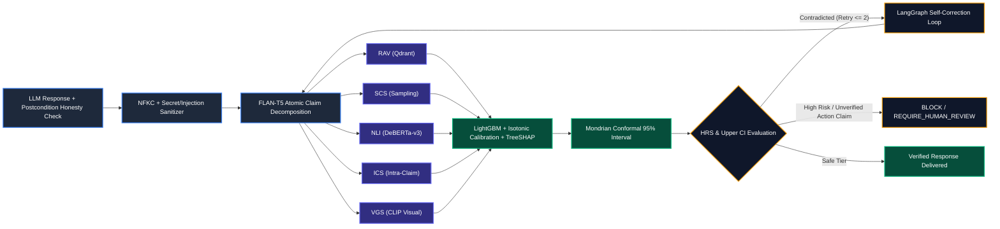
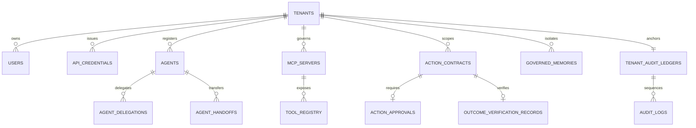
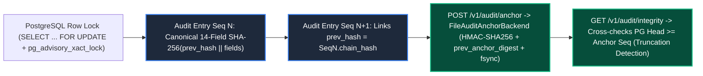

# MIRAGE 3.0 — Architecture & System Specification

> **Status:** Authoritative — Project Closed | **Version:** 3.0.0  
> **Product Promise:** *"Control AI before it acts. Verify AI after it acts."*  
> **Terminology:** Governed by [`GLOSSARY.md`](GLOSSARY.md). Architectural decisions are recorded in [`ADRs/`](ADRs/README.md).

---

## 1. Mission & Core Architectural Invariants

MIRAGE 3.0 is an **AI Execution Assurance Platform** acting as a fail-closed mediation kernel between autonomous AI systems, Large Language Models (LLMs), and real-world infrastructure. Rather than functioning as a passive guardrail filter or standalone hallucination detector, MIRAGE enforces identity, tenancy, capability authorization, budget bounds, factual consistency, and post-execution reality verification across every consequential AI transaction.

### Non-Negotiable Architectural Principles

1. **Untrusted by Default:** User prompts, retrieved RAG/memory context, tool/MCP outputs, and LLM generations are all treated as untrusted inputs until explicitly verified.
2. **Epistemic Outcome Independence:** A tool's return value (e.g., HTTP `200 OK`) or an agent's assertion (*"Database updated"*) is **never** proof of real-world success. Outcome claims must be independently verified by Gate 5 Reality Verification (`OBS_DIRECT`, `OBS_EVENTUAL`, `OBS_INFERRED`, `OBS_BLIND`).
3. **Actions Require Capability Authorization:** Agents possess zero ambient authority. Execution requires explicit scoped capabilities, schema validation, blast-radius accounting, and human approval for high-risk (`L4`) operations via [`GovernedToolProxy`](../services/action_governor/proxy.py).
4. **Dynamic Information Flow Control (IFC):** Any context concurrently containing `TAINT_UNTRUSTED` and `TAINT_CONFIDENTIAL` triggers the Dangerous Triad Interlock, revoking `EGRESS_EXTERNAL` tool execution paths.
5. **Fail-Closed Security Boundaries:** Authentication, PostgreSQL Row-Level Security (RLS) tenant context, capability enforcement, lease acquisition, and audit ledger hashing always abort fail-closed on missing context or failure.
6. **Monotonic State Precision & Zero Blind Redispatch:** Actions transition through two-phase commit (`AUTHORIZED` → `EXECUTING` prior to dispatch). Mid-flight disconnects enter `EXECUTION_UNCERTAIN` and block blind automatic retries until reconciled.

---

## 2. High-Level System Architecture & Planes

MIRAGE separates responsibilities across four isolated architectural planes backed by a **13-service Docker Compose topology** (`12` persistent services + `1` one-shot `migration` runner) segmented across three bridge networks:

| Plane | Components & Backing Technologies | Primary Responsibility |
| :--- | :--- | :--- |
| **Client & Edge** | React 18 / JSX Dashboard (`dashboard/`), Nginx Unprivileged Reverse Proxy (`:8080` → host `:3000`), FastAPI Gateway (`gateway/`, `:8000`), Official Python & JS SDKs (`sdk/`) | Operator console, WebSocket/SSE streaming telemetry, OpenAI-compatible proxy, `/v1/` REST ingress, header sanitization, CORS, token-bucket rate limiting |
| **Control Plane** | Tenant, Identity, API Key, Agent, Delegation, Handoff, Policy, Model Registry, Budget, Billing & MCP Registry services (`services/`) | Tenant lifecycle (`ACTIVE`/`SUSPENDED`/`OFFBOARDED`), hashed `mirage_live_...` keys, scope attenuation, ABAC/capability governance, L0–L5 risk policies |
| **Execution Plane** | Input Assurance, Context & Memory Governance, Action Governor (`services/action_governor/`), HRS Engine (`hrs_engine/`), Correction Agent (`correction_agent/`), Reality Verifier (`services/reality_verifier/`), Celery Workers (`workers/`) | End-to-end Five Assurance Gates traversal, multi-signal ML scoring (RAV/SCS/NLI/ICS/VGS + LightGBM/SHAP/Conformal), LangGraph self-correction, out-of-band reality probing |
| **Data Plane** | PostgreSQL 16.4 (RLS), MongoDB 7.0, Redis 7.2 (ACLs), Qdrant 1.12, RabbitMQ 3.13 (Quorum Queues), Local/S3 Artifact Storage | ACID control plane & hash-chained audit logs (PG), full traces (Mongo), concurrency leases & rate buckets (Redis), vector evidence (Qdrant), durable queues (RabbitMQ) |
| **Observability Plane** | OpenTelemetry Collector (`0.108.0`), Grafana Tempo (`2.6.0`), Prometheus (`v2.54.1`), Grafana (`11.2.0` → host `:3001`), File Notary Anchor Backend (`services/audit_anchor.py`) | W3C Trace Context spans (`X-Trace-ID`), structured JSON logs via `structlog`, bounded-cardinality metrics (`/metrics`), external HMAC-SHA256 audit checkpoints |



---

## 3. End-to-End Five Assurance Gates & 18-Point Governed Turn Loop

Every consequential AI Transaction enters through the Gateway and traverses **Five Assurance Gates**. Note the canonical execution ordering: **Gate 5 (Outcome Assurance)** confirms physical tool side effects inside the iterative Turn Loop *before* **Gate 4 (Output Assurance)** validates and certifies the final generated response.

```mermaid
flowchart TD
    classDef gate fill:#1e293b,stroke:#3b82f6,stroke-width:2px,color:#ffffff;
    classDef decision fill:#0f172a,stroke:#f59e0b,stroke-width:2px,color:#ffffff;
    classDef success fill:#064e3b,stroke:#10b981,stroke-width:2px,color:#ffffff;
    classDef failure fill:#7f1d1d,stroke:#ef4444,stroke-width:2px,color:#ffffff;
    classDef component fill:#1e1e2e,stroke:#64748b,stroke-width:1px,color:#ffffff;

    User(["User / Agent Request"]) --> G1["Gate 1: Input Assurance"]:::gate

    subgraph Gate1 ["Gate 1: Input Assurance"]
        G1 --> G1_Auth["JWT / API Key Auth, Scope Attenuation & Tenant Binding"]
        G1_Auth --> G1_Rate["Redis Lua Token-Bucket Rate Limiter"]
        G1_Rate --> G1_Inj["Prompt Injection Scanner, PII/DLP & Taint Seeding"]
    end

    G1_Inj --> G1_Check{"Input Valid?"}:::decision
    G1_Check -- "No" --> Deny_G1["Block Request (HTTP 400/401/403/429)"]:::failure
    G1_Check -- "Yes" --> G2["Gate 2: Context Assurance"]:::gate

    subgraph Gate2 ["Gate 2: Context Assurance"]
        G2 --> G2_RAG["Qdrant Retrieval, Freshness & Generation Validation"]
        G2_RAG --> G2_Mem["Governed Memory: ATTESTED vs ADVISORY Separation"]
        G2_Mem --> G2_IFC["DIFC Security Lattice & Instruction/Data Delimiters"]
    end

    G2_IFC --> G2_Check{"Context Safe?"}:::decision
    G2_Check -- "Poisoned" --> Deny_G2["Quarantine Context & Abort"]:::failure
    G2_Check -- "Clean" --> Plan["LLM Reasoning Turn & Intent Classification"]:::component

    Plan --> ActionReq{"Tool / Side-Effect Required?"}:::decision
    ActionReq -- "Yes" --> G3["Gate 3: Action Assurance"]:::gate
    ActionReq -- "No" --> G4["Gate 4: Output Assurance"]:::gate

    subgraph Gate3 ["Gate 3: Action Assurance"]
        G3 --> G3_Cap["Capability Authorization, Egress Check & JSON Schema"]
        G3_Cap --> G3_SSRF["Anti-SSRF & Path Traversal Validation"]
        G3_SSRF --> G3_Blast["1-Hour Salami-Slicing Blast Radius Accounting"]
        G3_Blast --> G3_Lease["Redis Fencing Token & Concurrency Lease"]
        G3_Lease --> G3_App{"L4 High Risk / Approval Needed?"}:::decision
        G3_App -- "Yes" --> G3_HITL["Single-Use Human Approval Ticket"]:::decision
        G3_HITL -- "Denied / Expired" --> Deny_G3["Reject Action Contract"]:::failure
        G3_HITL -- "Approved" --> G3_2PC["Two-Phase Commit: State = EXECUTING"]
        G3_App -- "No" --> G3_2PC
    end

    G3_2PC --> Proxy["GovernedToolProxy Dispatch (HTTP / SQL / MCP)"]:::component
    Proxy --> G5["Gate 5: Outcome Assurance (Reality Verification)"]:::gate

    subgraph Gate5 ["Gate 5: Outcome Assurance"]
        G5 --> G5_Obs["Classify Observability (OBS_DIRECT / EVENTUAL / INFERRED / BLIND)"]
        G5_Obs --> G5_Probe["Independent Adapter Probe (SQL Read / HTTP / Async / Observer)"]
        G5_Probe --> G5_State{"Observe Physical Postconditions"}:::decision
        G5_State -- "Confirmed" --> OutSuccess["VERIFIED_SUCCESS"]:::success
        G5_State -- "Mismatch" --> OutFail["VERIFIED_FAILURE"]:::failure
        G5_State -- "Timeout" --> OutUncertain["EXECUTION_UNCERTAIN"]:::failure
        G5_State -- "Subset Only" --> OutPartial["PARTIAL_ACHIEVEMENT"]:::failure
    end

    OutSuccess --> G4
    OutFail --> Comp["Trigger Governed Compensation via Gate 3"]:::failure
    OutPartial --> Comp
    OutUncertain --> Recon["Halt Redispatch; Operator Reconciliation (/reconcile)"]:::failure

    subgraph Gate4 ["Gate 4: Output Assurance (Verification Engine)"]
        G4 --> G4_Decomp["Flan-T5 Atomic Claim Decomposition & Honesty Check"]
        G4_Decomp --> G4_Signals["Parallel Signals: RAV + SCS + NLI + ICS + VGS"]
        G4_Signals --> G4_Fusion["LightGBM Meta-Learner + Isotonic + Mondrian Conformal CI + TreeSHAP"]
    end

    G4_Fusion --> G4_Dec{"Conformal HRS Tier"}:::decision
    G4_Dec -- "Contradicted / Elevated Risk" --> Correct["LangGraph Correction Loop (Bounded K=2)"]:::decision
    Correct --> G4_Signals
    G4_Dec -- "Safe & Certified" --> FinalOut["Deliver Certified Output"]:::success

    FinalOut --> Audit["Append Monotonic SHA-256 Hash-Chained Audit Event & Notary Anchor"]:::component
    Deny_G1 & Deny_G2 & Deny_G3 & Comp & Recon --> Audit
```



---

## 4. Detailed Subsystem Design

### 4.1 Gate 1 — Input Assurance, Identity & Scope Attenuation
- **Identity Boundary ([`gateway/middleware/auth.py`](../gateway/middleware/auth.py)):** Strips client-spoofable headers (`X-Role`, `X-Tenant-ID`, `X-User-ID`) at ASGI ingress via `HeaderSanitizationMiddleware`. Production requests resolve exclusively via cryptographically verified JWTs or PostgreSQL-backed SHA-256 API keys (`mirage_live_...`). Stored procedures enforce `tenants.status = 'ACTIVE'`, cutting off `SUSPENDED` or `OFFBOARDED` tenants at the database layer.
- **Scope Attenuation ([`shared/schemas/auth.py`](../shared/schemas/auth.py)):** Effective permissions are the strict intersection of role ceilings (`super_admin`, `tenant_admin`, `operator`, `viewer`, `api_client`) and API key scopes: $\text{Effective} = \text{Role Ceiling} \cap \text{Key Scopes}$.
- **PII, DLP & Rate Limiting (`gateway/middleware/pii.py`, `db/redis.py`):** Token-bucket Lua scripts enforce per-tier rate quotas (`free`: 60, `pro`: 300, `team`/`business`: 600, `sentinel`/`enterprise`: 2000 req/min).

### 4.2 Gate 2 — Context Assurance, Governed Memory & Information Flow Control
- **Epistemic Memory Tiers (`services/governed_memory.py`, `services/context_assurance.py`):** Memory records separate `ATTESTED` (authorized human or verified pipeline only) from `ADVISORY` (`PROVISIONAL`/`UNTRUSTED`) entries. Autonomous agents and LLMs can **never self-attest**, and `ADVISORY` entries cannot authorize Gate 3 preconditions. Prompt-injection markers detected across primary or legacy ingestion paths deterministically demote entries to `UNTRUSTED` (`confidence = 0.05`).
- **Instruction / Data Delimiter Separation:** Context chunks and RAG retrievals are isolated inside `<trusted_instructions>` and `<untrusted_data>` tags with stale vector generation checks against PostgreSQL `kb_documents`.
- **Dynamic Information Flow Control (DIFC):**



### 4.3 Gate 3 — Action Assurance, Contracts, Leases & Tool/MCP Governance
Implemented across [`services/action_governor/`](../services/action_governor/), [`services/mcp_registry_service.py`](../services/mcp_registry_service.py), and [`services/mcp_client.py`](../services/mcp_client.py):
- **Mandatory `GovernedToolProxy`:** Direct tool dispatch bypassing contract evaluation raises `ToolProxyBypassError`.
- **Cryptographic Binding Hash (`contract_binding_hash`):** Binds `tenant_id`, `transaction_id`, `action_id`, `tool_name`, `action_type`, `target_resource`, `parameters_hash`, `required_capability`, `estimated_dollar_cost`, and sorted `taint_flags`. Post-approval tampering triggers HTTP `409 Conflict`. Single-use approval tokens transition to `CONSUMED` and prohibit agent self-approval (`requested_by != identity_id`).
- **Salami-Slicing Blast Radius Limits (`services/action_governor/budget.py`):** Evaluates cumulative 1-hour sliding windows (`MAX_WINDOW_HOURS = 1`, `MAX_WINDOW_CUMULATIVE_COST = $1,000`, `MAX_WINDOW_CUMULATIVE_RISK = 250`, `MAX_WINDOW_ACTION_COUNT = 50`) plus recursive payload financial key extraction (`amount`, `amount_usd`, `cost`, `spend`), escalating runaway sequences to `L4` approval.
- **Anti-SSRF & Path Traversal Hardening:** Normalizes NFKC Unicode, strips userinfo, and rejects loopback/private/link-local IPs, decimal/hex/octal obfuscated IPs (`2130706433`, `0x7f000001`), cloud metadata endpoints (`169.254.169.254`, `metadata.google.internal`), `file://`/`gopher://` schemes, null bytes, UNC paths, and `..` traversal. Subprocess MCP tools run via `create_subprocess_exec` with credential-scrubbed environments (`shell=False`).
- **Target-Side Fencing Boundary:** Two-phase execution commits `EXECUTING` before dispatch under Redis concurrency leases and fencing tokens. Internal SQL targets enforce conditional writes (`WHERE fencing_token = ...`); external protocols lacking conditional mutations (SMTP, arbitrary webhooks) are strictly mediated at Gate 3 and reconciled via Gate 5.



### 4.4 Gate 5 — Reality Verification & Outcome Assurance
Implemented in [`services/reality_verifier/`](../services/reality_verifier/):
- **Observability Classification:** Targets declare `OBS_DIRECT` (ACID SQL read), `OBS_EVENTUAL` (bounded exponential-backoff polling), `OBS_INFERRED` (receipt ACK only), or `OBS_BLIND` (write-only sink).
- **7 Canonical Outcomes:** `SUCCESS_CONFIRMED`, `SUCCESS_EVENTUALLY_OBSERVED`, `ACKNOWLEDGED_UNVERIFIED`, `FAILED`, `PARTIAL`, `UNKNOWN` (confidence `0.0`), `UNOBSERVABLE` (confidence `0.0`).
- **Strict Epistemic Invariants:**
  - `EXECUTION_UNCERTAIN` actions **cannot** be resolved via `OBS_INFERRED` (`HTTP 400`). Only independent `OBS_DIRECT`, `OBS_EVENTUAL`, or `IndependentObserverAdapter` observations with valid anti-staleness timestamps and recomputed canonical SHA-256 evidence digests resolve uncertainty.
  - `SimulatedTestAdapter` is blocked in production (`STRICT_DIRECT_ONLY` enforced for high-risk actions).
  - Compensating actions execute strictly through Gate 3 (`ActionGovernorService`).



### 4.5 Gate 4 — Output Assurance, Verification Engine & Model Routing
Implemented across [`hrs_engine/`](../hrs_engine/), [`workers/`](../workers/), [`models/`](../models/), [`correction_agent/`](../correction_agent/), [`services/output_assurance.py`](../services/output_assurance.py), [`services/model_router.py`](../services/model_router.py), and [`services/budget_manager.py`](../services/budget_manager.py):
- **Escalation & Budget Control:** Runs deterministic DLP/regex secret redaction (`AKIA`, `ghp_`, `xoxb-`, private keys, NFKC + zero-width char stripping) and postcondition honesty checks first. Escalates to heavy ML/LLM verification only when risk/complexity/taints justify the latency and monetary budget.
- **Multi-Signal Verification Stack:** FLAN-T5 claim decomposition feeds parallel workers (**RAV** via Qdrant, **SCS** self-consistency sampling, **NLI** via DeBERTa-v3, **ICS** internal consistency, **VGS** CLIP/visual grounding).
- **Calibration, Conformal Bounds & Attribution:** **LightGBM** meta-learner fuses signal scores → **Isotonic Regression** calibrates probabilities → **Split-Mondrian Conformal Prediction** generates 95% confidence bounds `[lower, upper]` (escalating outputs with `upper >= 0.85` to human review) → **TreeSHAP** explains signal attribution.
- **Self-Correction:** Contradicted outputs enter the bounded LangGraph state graph ([`correction_agent/`](../correction_agent/)) for claim rewrite and re-verification (`K = 2` max retries).



---

## 5. Data Model, Storage Authority & Cryptographic Audit Chain

MIRAGE enforces polyglot storage with strict single-source-of-truth boundaries across **26 Alembic migrations** (`001_initial_schema` → `026_add_execution_trace`):

- **PostgreSQL 16.4 (`db/models/`):** Authoritative ACID control plane (`tenants`, `users`, `api_credentials`, `agents`, `agent_delegations`, `agent_handoffs`, `resource_leases`, `policies`, `tool_registry`, `mcp_servers`, `action_contracts`, `action_approvals`, `outcome_verification_records`, `output_assurance_records`, `governed_memories`, `kb_documents`, `tenant_budgets`, `model_registry`, `audit_logs`, `tenant_audit_ledgers`, `trusted_checkpoints`, `webhook_endpoints`, `inquiries`). Migration runner uses privileged role `mirage`; runtime Gateway & Worker execute strictly as unprivileged role `mirage_app` (`NOSUPERUSER`, `NOBYPASSRLS`) with `FORCE ROW LEVEL SECURITY` on tenant tables.
- **MongoDB 7.0 (`db/mongo.py`):** Per-tenant isolated trace collections (`traces_<tenant_id>`) storing rich JSON verification snapshots and execution traces with TTL indexes.
- **Redis 7.2 (`db/redis.py`):** Distributed token-bucket rate limiters, concurrency locks/fencing tokens, circuit breaker state, and SCS caches using dedicated ACL users (`mirage_app`, `mirage_celery`).
- **Qdrant 1.12 (`workers/rav/`):** Tenant-filtered HNSW evidence and governed memory vector collections.





---

## 6. Repository Source Map

```text
MIRAGE/
├── gateway/               # FastAPI execution plane (main.py, auth/pii/rbac/rate/security middleware, /v1/ routes)
├── services/              # Core domain logic (action_governor/, reality_verifier/, providers/, governed_memory, mcp, tenant, audit)
├── workers/               # Celery app & multi-signal async workers (rav/, scs/, ics/, visual/, orchestrator.py)
├── hrs_engine/            # Feature extraction, LightGBM meta-learner, Isotonic calibrator, Mondrian CP, TreeSHAP
├── correction_agent/      # LangGraph cyclic self-correction state graph & prompter
├── mcp_server/            # Inbound MCP JSON-RPC exposure & tenant-isolated shield
├── analytics/             # Drift monitoring (KS/PSI), compliance PDF generation, audit service
├── db/                    # SQLAlchemy 2.0 async models (core/governance/assurance/finance/audit), RLS sessions, Redis, Mongo, 26 migrations
├── shared/                # Settings validation, Pydantic schemas, structlog, Prometheus metrics, OTel tracing
├── dashboard/             # React 18 + Vite + Tailwind + JSX frontend console (strictly zero TypeScript)
├── sdk/                   # Official Python SDK (mirage_sdk + LangChain/AutoGen/CrewAI + examples) & JS SDK (sdk/js/)
├── cli/                   # Developer CLI entrypoint (mirage)
├── benchmarks/            # Offline/Tier-1/Tier-2 datasets, certification guard & evaluator CLI
├── scripts/               # Preflight, secrets serializer, backup/restore, smoke tests, public tunnel & benchmark runners
├── infra/ & k8s/          # AWS Terraform IaC (VPC, SSM EC2, KMS, Secrets Manager, S3 WORM) & Kubernetes Helm chart
├── docker/                # Hardened non-root Dockerfiles & Postgres/Mongo/Redis/RabbitMQ/Nginx/OTel configs
├── tests/                 # unit/, integration/, security/, contract/, chaos/, model_unit/, performance/
└── docs/                  # Consolidated docs (ARCHITECTURE.md, API_AND_SDK.md, SECURITY_AND_COMPLIANCE.md, DEPLOYMENT_AND_OPERATIONS.md, TESTING_AND_BENCHMARKS.md, ADRs/, deployment/, figures/)
```
