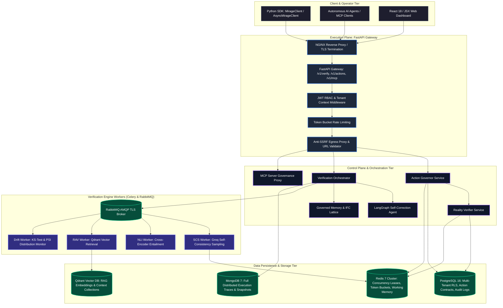
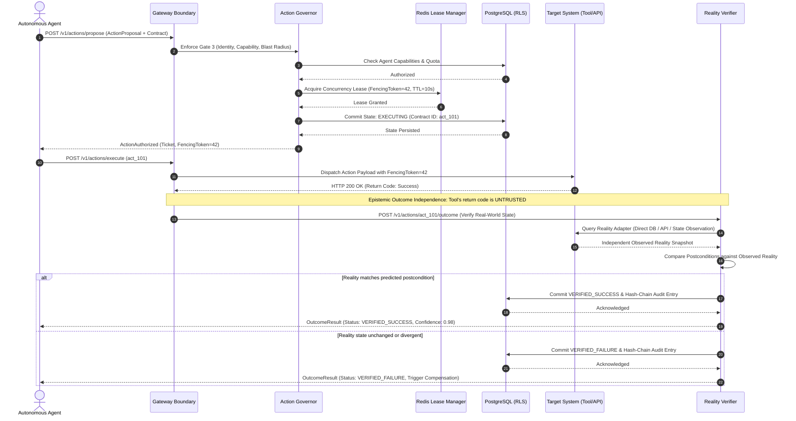
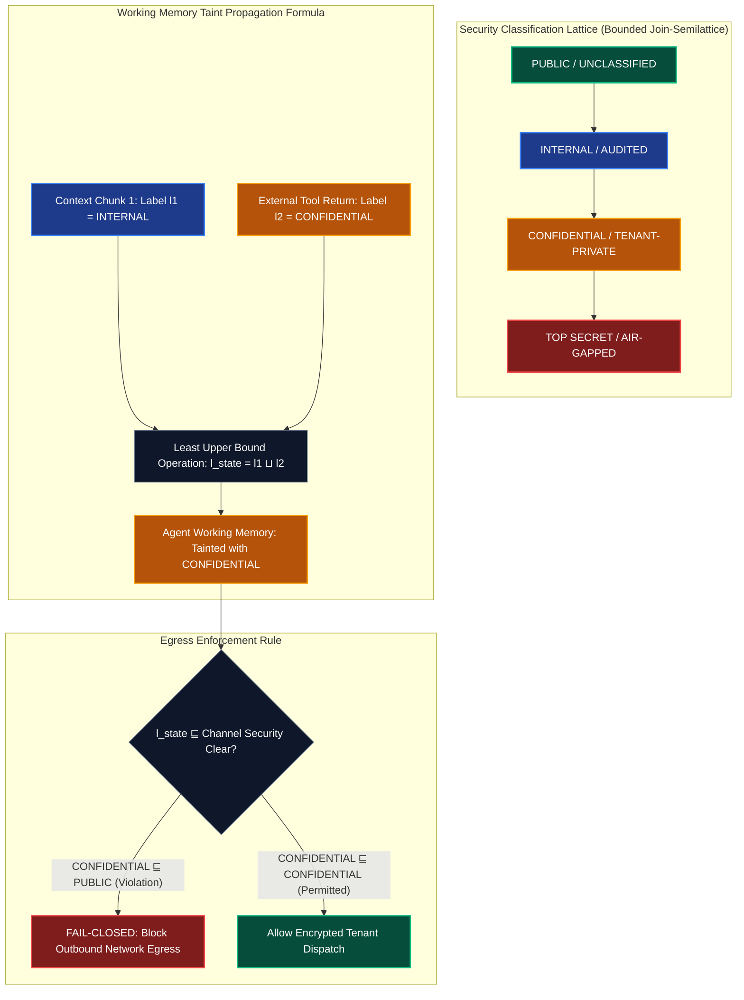
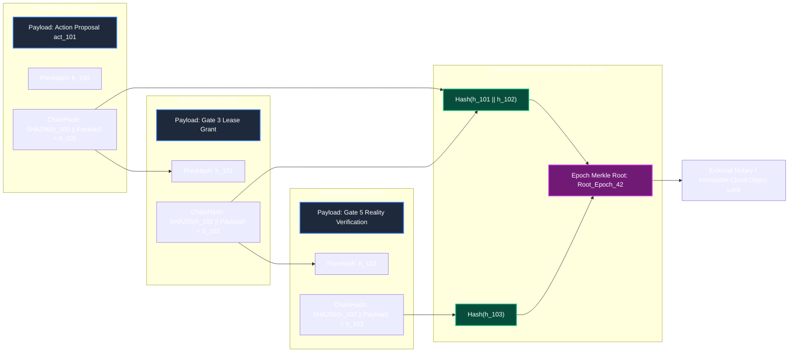
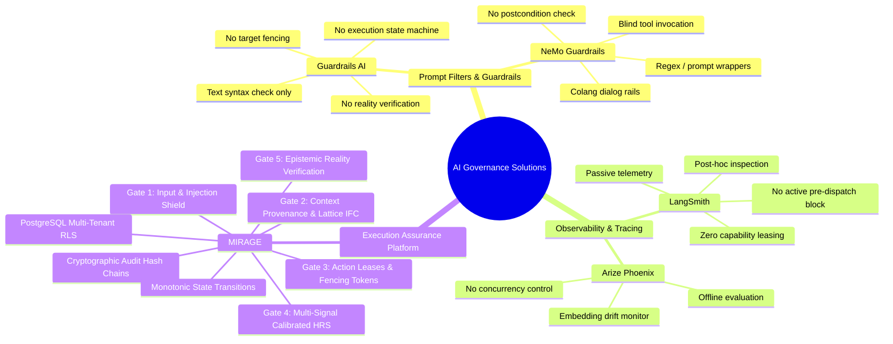

# MIRAGE: Architectural Diagrams and System Workflows (Mermaid Specifications)

This document contains authoritative Mermaid diagrams for the **MIRAGE AI Execution Assurance Platform**. These diagrams correspond directly to the technical specifications in the master project report and can be rendered into high-resolution images (SVG/PNG) for documentation, slide decks, and LaTeX reports.

---

## 1. End-to-End Five Assurance Gates Pipeline

This diagram illustrates the chronological lifecycle of an AI request traversing all Five Assurance Gates—from user prompt ingestion to post-action reality verification.

```mermaid
flowchart TD
    classDef gate fill:#1e293b,stroke:#3b82f6,stroke-width:2px,color:#ffffff;
    classDef decision fill:#0f172a,stroke:#f59e0b,stroke-width:2px,color:#ffffff;
    classDef success fill:#064e3b,stroke:#10b981,stroke-width:2px,color:#ffffff;
    classDef failure fill:#7f1d1d,stroke:#ef4444,stroke-width:2px,color:#ffffff;
    classDef component fill:#1e1e2e,stroke:#64748b,stroke-width:1px,color:#ffffff;

    User([User / Agent Application]) --> G1[Gate 1: Input Assurance]

    subgraph Gate1 ["Gate 1: Input Assurance"]
        G1 --> G1_Auth[JWT / API Key Verification & Tenant Attribution]
        G1_Auth --> G1_Inj[Prompt Injection & Jailbreak Defense]
        G1_Inj --> G1_DLP[DLP & Secret Masking]
        G1_DLP --> G1_Rate[AST Leaky-Bucket Rate Limiter]
    end

    G1_Rate --> G1_Check{Input Valid?}:::decision
    G1_Check -- No --> Deny_G1[Deny Request & Log Violation]:::failure
    G1_Check -- Yes --> G2[Gate 2: Context Assurance]

    subgraph Gate2 ["Gate 2: Context Assurance"]
        G2 --> G2_RAG[RAG Retrieval from Qdrant Vector Store]
        G2_RAG --> G2_Prov[Evidence Provenance & Staleness Validation]
        G2_Prov --> G2_Taint[Information Flow Control: Security Lattice Taint Tracking]
    end

    G2_Taint --> G2_Check{Context Clean?}:::decision
    G2_Check -- Poisoned --> Deny_G2[Quarantine Context & Abort]:::failure
    G2_Check -- Clean --> Agent_Think[LLM / Multi-Agent Reasoning]:::component

    Agent_Think --> Action_Req{Requires Tool / Action?}:::decision
    Action_Req -- Yes --> G3[Gate 3: Action Assurance]
    Action_Req -- No --> G4[Gate 4: Output Assurance]

    subgraph Gate3 ["Gate 3: Action Assurance"]
        G3 --> G3_Cap[Capability-Based Access Control]
        G3_Cap --> G3_Trust[Tool Registry Trust & Health Scoring]
        G3_Trust --> G3_Schema[JSON Schema Parameter Validation]
        G3_Schema --> G3_Blast[Sliding-Window Blast Radius Limiting]
        G3_Blast --> G3_Lease[Distributed Lease & Fencing Token Acquisition]
        G3_Lease --> G3_Approval{High Risk / Approval Required?}:::decision
        G3_Approval -- Yes --> G3_HITL[Human-In-The-Loop Approval Ticket]:::decision
        G3_HITL -- Denied --> Deny_G3[Cancel Action Contract]:::failure
        G3_HITL -- Approved --> G3_Commit[Two-Phase Commit: Mark EXECUTING]
        G3_Approval -- No --> G3_Commit
    end

    G3_Commit --> Dispatch[Dispatch Action to External Target / Tool]:::component
    Dispatch --> G5[Gate 5: Outcome Assurance]

    subgraph Gate5 ["Gate 5: Outcome Assurance"]
        G5 --> G5_Probe[Query Verifier Adapter: DB / REST / Queue / Log]
        G5_Probe --> G5_Indep[Epistemic Reality Check: Independent State Observation]
        G5_Indep --> G5_State{Evaluate Observed State vs Contract Postconditions}:::decision
        G5_State -- Verified --> State_Success[VERIFIED_SUCCESS]:::success
        G5_State -- Mutation Failed --> State_Fail[VERIFIED_FAILURE]:::failure
        G5_State -- Network Timeout --> State_Uncertain[EXECUTION_UNCERTAIN]:::failure
        G5_State -- Partial Transition --> State_Partial[PARTIAL_ACHIEVEMENT]:::failure
    end

    State_Success --> G4
    State_Fail --> Rollback[Trigger Compensating Action]:::failure
    State_Uncertain --> Reconcile[Reconciliation Alert & Audit Lock]:::failure
    State_Partial --> Rollback

    subgraph Gate4 ["Gate 4: Output Assurance"]
        G4 --> G4_Decomp[Atomic Claim Decomposition via Flan-T5]
        G4_Decomp --> G4_Signals[Multi-Signal Verification: RAV + SCS + NLI + ICS + VGS]
        G4_Signals --> G4_Fusion[HRS Score Fusion via LightGBM & TreeSHAP]
        G4_Fusion --> G4_Calib[Split-Mondrian Conformal Prediction Calibration]
    end

    G4_Calib --> G4_Check{HRS in Safe Tier?}:::decision
    G4_Check -- Hallucination / Contradiction --> G4_Correct[LangGraph Iterative Self-Correction Loop]:::decision
    G4_Correct --> G4_Signals
    G4_Check -- Verified Accurate --> Final_Success[Return Certified Output to User]:::success

    Final_Success --> Audit[Append to SHA-256 Monotonic Audit Hash Chain]:::component
    Deny_G1 --> Audit
    Deny_G2 --> Audit
    Deny_G3 --> Audit
    State_Fail --> Audit
    State_Uncertain --> Audit
```



---

## 2. High-Level Architecture (HLD) & Distributed Topology

This diagram details the operational infrastructure, multi-tiered networks, core services, asynchronous workers, and persistent datastores.



---

## 3. Action Lifecycle Monotonic State Machine

Formal state transitions governing action contracts from proposal to terminal verification. State transitions are strictly monotonic and fail-closed.

```mermaid
stateDiagram-v2
    [*] --> PROPOSED: Agent proposes tool action (Gate 3)
    
    PROPOSED --> AUTHORIZED: Capability verified, schema valid, blast-radius OK
    PROPOSED --> REJECTED: Insufficient permissions, schema error, or budget exceeded
    
    AUTHORIZED --> EXECUTING: Lease acquired, fencing token bound, pre-dispatch commit
    AUTHORIZED --> REJECTED: Approval ticket expired or rejected by human
    
    EXECUTING --> VERIFIED_SUCCESS: Gate 5 proves postconditions confirmed in reality
    EXECUTING --> VERIFIED_FAILURE: Target mutation failed or returned error state
    EXECUTING --> EXECUTION_UNCERTAIN: Network timeout / connection reset mid-flight
    EXECUTING --> PARTIAL_ACHIEVEMENT: Sub-operations succeeded but complete postcondition unmet

    EXECUTION_UNCERTAIN --> VERIFIED_SUCCESS: Re-observation confirms state mutation completed
    EXECUTION_UNCERTAIN --> VERIFIED_FAILURE: Re-observation confirms state remained untouched
    
    VERIFIED_FAILURE --> COMPENSATION_PENDING: Trigger registered rollback action
    PARTIAL_ACHIEVEMENT --> COMPENSATION_PENDING: Trigger registered rollback action
    
    COMPENSATION_PENDING --> COMPENSATED: Rollback successfully verified in reality
    COMPENSATION_PENDING --> COMPENSATION_FAILED: Rollback failed; operator manual intervention required
    
    REJECTED --> [*]
    VERIFIED_SUCCESS --> [*]
    COMPENSATED --> [*]
    COMPENSATION_FAILED --> [*]
```



---

## 4. Sequence Diagram: Governed Tool Execution with Reality Verification

Detailed message sequence across the client, Action Governor, Redis Lease Manager, PostgreSQL database, external target tool, and Reality Verifier.



---

## 5. Gate 4 Verification Engine: Claim Decomposition & Conformal Calibration

Architecture of the factual consistency pipeline inside Gate 4, showcasing claim decomposition, multi-signal parallel scoring, conformal calibration, and LangGraph self-healing.

```mermaid
flowchart TD
    classDef input fill:#1e293b,stroke:#3b82f6,stroke-width:2px,color:#ffffff;
    classDef worker fill:#312e81,stroke:#6366f1,stroke-width:2px,color:#ffffff;
    classDef fusion fill:#064e3b,stroke:#10b981,stroke-width:2px,color:#ffffff;
    classDef correct fill:#701a75,stroke:#d946ef,stroke-width:2px,color:#ffffff;
    classDef decision fill:#0f172a,stroke:#f59e0b,stroke-width:2px,color:#ffffff;

    RawText[LLM Raw Generated Response]:::input --> Decomp[Flan-T5 Claim Decomposer]

    subgraph Claims ["Atomic Claim Extraction"]
        Decomp --> C1["Claim 1: Atomic factual assertion"]
        Decomp --> C2["Claim 2: Numerical assertion"]
        Decomp --> CN["Claim N: Relational assertion"]
    end

    subgraph Signals ["Parallel Signal Extraction Engine"]
        C1 & C2 & CN --> S_RAV[RAV: Qdrant Vector Retrieval Evidence]:::worker
        C1 & C2 & CN --> S_SCS[SCS: Groq Temperature Perturbation Consistency]:::worker
        C1 & C2 & CN --> S_NLI[NLI: DeBERTa-v3 Cross-Encoder Entailment]:::worker
        C1 & C2 & CN --> S_ICS[ICS: Internal Context Consistency]:::worker
        C1 & C2 & CN --> S_VGS[VGS: Visual Grounding Signal]:::worker
    end

    S_RAV & S_SCS & S_NLI & S_ICS & S_VGS --> Fusion[LightGBM Tree-Ensemble Fusion Engine]:::fusion

    subgraph Calibration ["Mathematical Rigor: Conformal Risk Control"]
        Fusion --> RawHRS[Compute Raw Hallucination Risk Score]
        RawHRS --> Conformal[Split-Mondrian Conformal Prediction Calibrator]
        Conformal --> Bounds[Compute 95% Confidence Interval: Upper & Lower Bounds]
        Bounds --> Tier{Categorize Risk Tier}:::decision
    end

    Tier -- "Low Risk (HRS < 0.35)" --> Pass[Certified Output: Deliver to Client]:::fusion
    Tier -- "Medium Risk (0.35 <= HRS < 0.70)" --> LangGraph[LangGraph Iterative Self-Correction Node]:::correct
    Tier -- "High Risk (HRS >= 0.70)" --> Reject[Strict Denial: Fail-Closed Suppression]

    subgraph Correction ["LangGraph Self-Correction Cycle"]
        LangGraph --> GenerateFix[Generate Targeted Counter-Claim Correction]
        GenerateFix --> ReCheck{Iteration <= Max (3)?}:::decision
        ReCheck -- Yes --> Decomp
        ReCheck -- No --> Reject
    end
```

---

## 6. Information-Flow Control: Security Lattice & Working Memory Taint

Formal security lattice enforcing dynamic taint tracking across agent working memory and preventing indirect prompt injection or context leakage.



---

## 7. Cryptographic Audit Chain & Merkle Ledger Checkpoints

Cryptographic data structure guaranteeing tamper-evident audit records, monotonic sequence verification, and external notary anchoring.



---

## 8. Capability Comparison Matrix: Existing Solutions vs. MIRAGE

Radar / Feature breakdown demonstrating the architectural differentiation of MIRAGE compared to existing prompt filters and observability wrappers.


